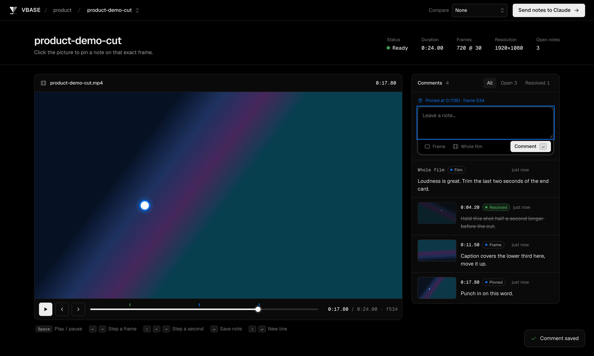
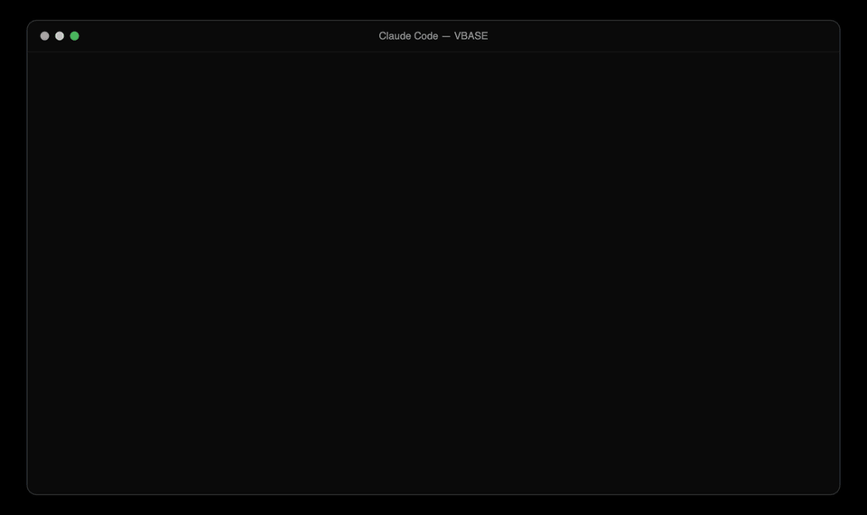
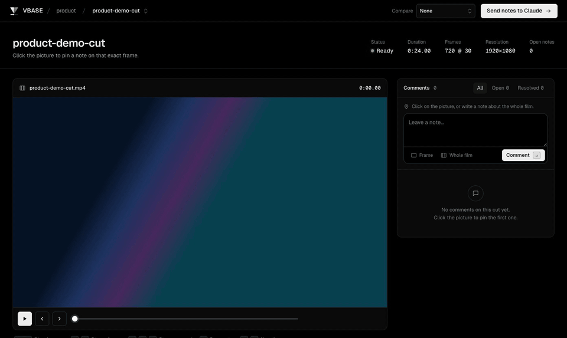
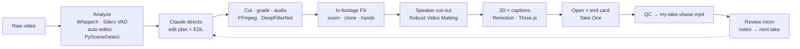

<div align="center">


# VBASE

**Raw take in. Edited video out.**<br>
A Claude Code plugin that edits your talking-head videos: cuts, captions, 3D effects, camera moves,<br>and review notes pinned to exact frames, which Claude turns into the next take.

[](#install)
[](LICENSE)
[](#requirements)



<sub>The VBASE review room: pin notes on exact frames, then send them to Claude for the next take.</sub>

</div>

---

> **A starting point, not a black box.** VBASE gets a raw take to a polished first cut on its own, then you steer it:
> pin notes on frames in the review room and every note becomes the next take. Everything is plain scripts and
> React scenes in this repo, so you can change any part of it. Its own launch video was edited this way, over 16 takes.

## Quick start



**1. Install** — paste into your terminal:

```bash
claude plugin marketplace add ekanshvcpkg/VBASE && claude plugin install vbase@vbase
```

**2. Set up** — once, inside Claude Code (about 5–10 minutes):

```text
/vbase:setup
```

**3. Edit** — any video:

```text
/vbase:edit ~/Downloads/take.mov
```

You get `take-vbase.mp4` next to your video, and the VBASE review room opens in your browser at `http://localhost:4400`.

<details>
<summary>Prefer installing from inside Claude Code?</summary>

Run these one at a time:

```text
/plugin marketplace add ekanshvcpkg/VBASE
```
```text
/plugin install vbase@vbase
```

</details>

> [!TIP]
> You can also just talk to Claude: *"edit ~/Downloads/take.mov with vbase, make it vertical, my name is Ada"*.
> Then run `/vbase:review ~/Downloads/take.mov` to pin notes on frames and get the next take.

<sub>The walkthrough above is illustrated; the setup table and stage results are real output from a VBASE test run.</sub>

## What it does

| | |
|---|---|
| **Cuts that sound human** | Word-level timing (WhisperX) plus speech detection (Silero VAD). Pauses are compressed, not chopped; fumbles, filler and tangents go. |
| **Captions** | Word-by-word, highlighted on the words that matter, kept clear of panels. |
| **3D in your hands** | A real WebGL object (pebbled leather, seams, room lighting, motion blur) tracked to your palms with MediaPipe, thrown and caught. |
| **Camera moves** | Spring-eased push-ins and pull-outs, jump-zoom punches, whip pans, zoom-blur transitions. |
| **Graphics behind you** | Glass cards, chips and whole screens (a GitHub page, an app) sit in the room *behind* you: a clean cut-out of you (Robust Video Matting) goes on top, and each element is placed in the free wall beside your head, never on your face. |
| **A 3D buddy that joins in** | An original clay character that peeks in from the corners, runs across the room, hugs a title card, stomps the Star button on your repo and presses the call-to-action on the end card. |
| **Floating windows** | Screen recordings and code open as angled 3D windows on the side you point to. |
| **A clone of you** | Your own cut-out, placed behind you with a cast shadow and light wrap, appearing on the word you say. |
| **Proof, not decoration** | Scenes show real output: a grid of frames from the edit, raw vs edited side by side, the actual numbers of the run. |
| **Open + end card** | Built with [Take One](https://github.com/talsiach/take-one): a raw-to-edit wipe under your voice from frame 0, your name, and an end card with a call to action. |
| **Studio audio** | Neural denoise (DeepFilterNet), vocal chain, two-pass loudness to −14 LUFS. |
| **Music and sound, made in code** | An original under-voice music bed composed in code and fitted to the exact length (free, no licence worries), kept low and steady; quiet pop sounds only where something appears, on its exact frame. |
| **Hand-off** | An OpenTimelineIO timeline (`.otio`) to keep editing in DaVinci Resolve or Premiere. |


## The review room: notes pinned to the exact frame



This is the core idea of VBASE. Most AI editors give you one shot and a text box. VBASE gives you a review room like a
real post-production house: you watch the take, **click on the exact spot in the picture** that bothers you, write what you
want, and press **Send notes to Claude**. It opens by itself after every edit at `http://localhost:4400`
(or run `/vbase:review ~/Downloads/my-take.mov`), and it runs only on `localhost`: nothing is uploaded.

**What Claude receives for every note**

| Field | Example | Why it matters |
|---|---|---|
| Take | `my-take-vbase-v11.mp4` | Notes stay pinned to the version you watched, even after newer takes exist. |
| Time and frame | `24.266 s` · frame `728` | The exact moment, to the frame (30 fps). |
| Position in the picture | `x 0.26, y 0.55` | Where you clicked, as a fraction of the frame. "This" and "here" have a meaning. |
| Snapshot | `shots/<id>.jpg` | The frame itself with your pin drawn in, so Claude *sees* what you saw. |
| Your words | *"it's covering my face, move it"* | Plain language, any length. Leave the position empty for a note on the whole film. |
| Status | open / resolved | Resolved notes are kept but not acted on again. |

**How Claude turns that into an exact fix.** Every take is built from one edit decision list, so a frame number is not a
guess. Claude looks it up and knows:

- **the word you were saying** at that frame, and where it sits in the raw take (every cut keeps its source time);
- **what was on screen**: which graphic, card, window or effect, when it started, and its animation beats;
- **what you clicked on**: the element under your pin, compared with the speaker's face box and the free wall space
  measured for that shot;
- **why it is there**: the edit plan and the cut audit say why each cut and each graphic was chosen.

So *"it's covering my face"* at `x 0.26, y 0.55` becomes "move the VBASE card at 23.3 s out of the face box, into the free
wall on the left", not "regenerate the whole video". Each round renders the next take (`-v2`, `-v3` …). The review room
picks it up on its own, and Claude marks each note it answered as resolved. VBASE's own launch video went through 16 takes this way.
Real notes from those rounds included "the zoom has jitter", "this looks very AI", "put it behind me" and "the music is too loud".

## What Claude knows before it edits

Claude never edits blind. The analyze stage turns your raw take into structured data, and every creative decision is
written against it:

| Data | Made by | Used for |
|---|---|---|
| Every word with its start and end time | WhisperX (`large-v3-turbo`) | Cutting between words, never through them; word-by-word captions; graphics that land on the word you say. |
| Speech regions | Silero VAD | Telling a thinking pause from dead air. |
| Silences and room tone | FFmpeg `silencedetect` | Compressing pauses by type instead of chopping them; a room-tone bed under every cut. |
| A first silence pass | auto-editor | A second opinion on what can go. |
| Scene and shot changes | PySceneDetect | Respecting existing cuts in the footage. |
| Format, length, frame rate, a probe frame | ffprobe | Choosing the output shape and the speaker-centred crop. |
| Where your face is | MediaPipe | Framing, and keeping text and graphics off your face. |
| Your editing profile | onboarding (`~/.vidbase/profile.json`) | Your style on every video without being asked again: format, captions, pace, name, links. |

Claude then writes two things. **`edit_plan.md`** holds the hook, the emotional spine, what to cut and why, and which line
gets which visual. **`edl_draft.json`** holds the same decisions as data, anchored to word IDs rather than guessed
timestamps. The scripts do the frame-accurate arithmetic:

- `master_edl.json`: every kept segment with its source time, every graphic with its time window and beats;
- `cut_audit.json`: every jump cut, the seconds removed, the kind of pause, and the words on either side.

While rendering, VBASE measures more of the picture: your hands (for objects you hold), a clean cut-out of you in every
frame (Robust Video Matting, so graphics can sit behind you), and the free wall beside your head for each graphic.

**Before you see a take**, a self-review checks loudness (−14 LUFS) and true peak, black frames, on-screen text size
and the composition. Only a take that passes goes to the review room.

## How it works



Claude makes the creative calls; deterministic scripts make every frame-accurate move. The loop back from the review room is what turns a good first cut into the one you want.

## Commands

| Command | What it does |
|---|---|
| `/vbase:setup [--check]` | Install or check dependencies. |
| `/vbase:edit <video> [notes]` | Edit a video end to end. Add notes in plain words: *"make it vertical"*, *"my name is Ada"*, *"no open"*. |
| `/vbase:review <video>` | Open the review room and turn your notes into the next take. |

You can also just ask: *"edit ~/Downloads/take.mov with vbase"*.

<details>
<summary><b>Options</b> (Claude sets these from what you say; you can too)</summary>

| Env | Effect |
|---|---|
| `ZOOM_WORD=zoom` | Camera pushes in on the word's first use, pulls out on its second. |
| `CLONE_AT=<seconds> CLONE_WORD=<word>` | A clone cut from that moment of the raw take appears behind you on that word. |
| `BRAND`, `LINE1`, `LINE2`, `TAGLINE`, `END1`, `END2`, `CTA`, `FOOT` | Words of the open and end card. |
| `MUSIC=code` | Compose VBASE's own background bed in code: free, fitted to the exact length, at one steady, low level under your voice. |
| `SFX=1` | Quiet pop sounds only where a visual pops in, timed to its frame and tuned to the bed (off by default). |
| `VBASE_GRADE=natural` | Keep the camera's own colours (no colour grade). |
| `MUSIC_FILE=track.mp3` | Your own background music at one steady, low level under your voice (`MUSIC_LUFS`, default −44). |
| `TAKEONE=0` | Skip the open and end card. |

</details>

## Requirements

- **Claude Code**
- **macOS** (tested on Apple silicon). Linux should work but is untested.
- **Homebrew**, plus a Chromium browser for rendering: **Google Chrome, Brave, Edge or Chromium**.
- About **5 GB** of disk for models and tools. Setup installs: ffmpeg, Node, uv, auto-editor, Python 3.11 tools (WhisperX, Silero VAD, PySceneDetect, OpenTimelineIO), MediaPipe models, the Robust Video Matting model, DeepFilterNet and Take One.

No paid API is needed. Music and voice from ElevenLabs are optional and off unless you add a key.

## Project layout

```text
.claude-plugin/     plugin.json, marketplace.json
commands/           /vbase:edit, /vbase:setup, /vbase:review
skills/vbase/       the editing skill: stages, scene library, Remotion template, scripts
pipeline/           in-footage FX, editor FX timeline, Take One finish, OTIO export
review-room/        the VBASE review room (local server + page)
scripts/            setup.sh (one-time install), run.sh (analyze / render / review)
```

## Honest limits

- It edits one continuous talking-head take best. Multi-camera footage and B-roll libraries are not supported yet.
- The 3D object rests on your palm; your fingers do not wrap in front of it.
- Effects such as the clone and the zoom need you to say the trigger words, so they appear where you talk about them.
- The first take is a strong start, not a final cut: expect a few rounds of notes in the review room.
- Elements behind you need a clear outline of you; very busy backgrounds or people walking behind you make the cut-out less clean.
- Rendering a 1-minute video takes a few minutes on an M-series Mac.

## Credits

VBASE stands on excellent open-source work. It installs these from their own sources; none are redistributed here.

| Project | Used for | License |
|---|---|---|
| [WhisperX](https://github.com/m-bain/whisperX) | word-level timestamps | BSD-2-Clause |
| [Silero VAD](https://github.com/snakers4/silero-vad) | speech detection | MIT |
| [auto-editor](https://github.com/WyattBlue/auto-editor) | silence pass | Unlicense |
| [PySceneDetect](https://github.com/Breakthrough/PySceneDetect) | scene cuts | BSD-3-Clause |
| [OpenTimelineIO](https://github.com/AcademySoftwareFoundation/OpenTimelineIO) | timeline export | Apache-2.0 |
| [FFmpeg](https://github.com/FFmpeg/FFmpeg) | cutting, grading, audio | LGPL/GPL |
| [Take One](https://github.com/talsiach/take-one) | open, end card, audits, sound | MIT |
| [Remotion](https://www.remotion.dev) + [Three.js](https://threejs.org) | 3D scenes and captions | [Remotion License](https://www.remotion.dev/license) (free for individuals and small teams) · MIT |
| [MediaPipe](https://github.com/google-ai-edge/mediapipe) | hand tracking, face boxes | Apache-2.0 |
| [Robust Video Matting](https://github.com/PeterL1n/RobustVideoMatting) | speaker cut-out (elements behind you) | GPL-3.0 (model downloaded by setup, not redistributed) |
| [DeepFilterNet](https://github.com/Rikorose/DeepFilterNet) | denoise | MIT / Apache-2.0 |
| [video-use](https://github.com/browser-use/video-use) | editing rules that shaped the cut | MIT |

Take One renders through Chrome only by default; `setup.sh` applies a one-line patch so it can use any Chromium browser (`CHROME_PATH`).

## License

[MIT](LICENSE) © Ekansh
