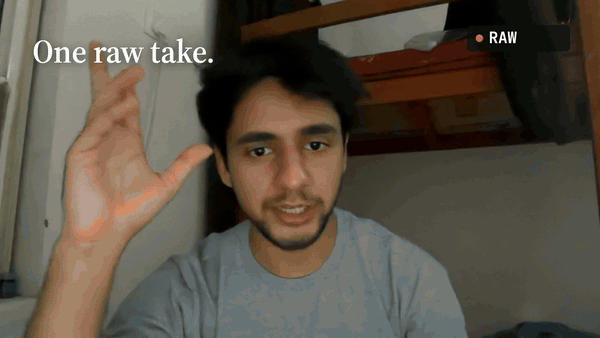
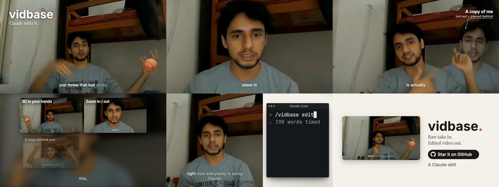
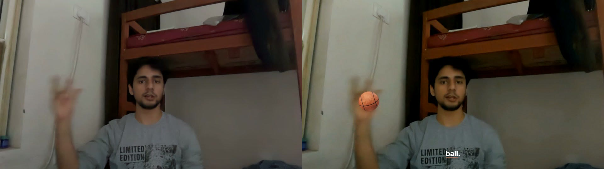
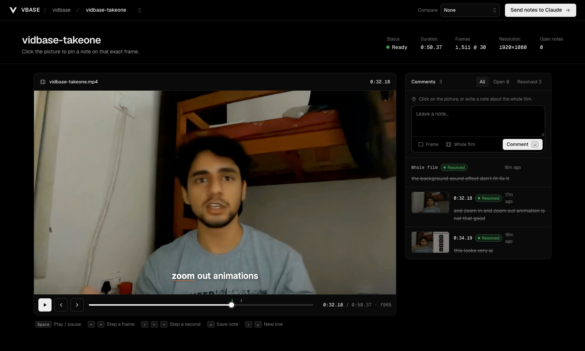
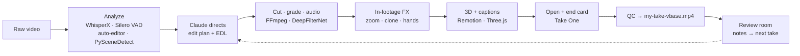

<div align="center">


# VBASE

**Raw take in. Edited video out.**<br>
A Claude Code plugin that edits your talking-head videos: word-timed cuts, captions, 3D objects in your hands,<br>camera moves, a clone of you, a launch-style open and end card, and a review room for your notes.

[](#install)
[](LICENSE)
[](#requirements)



<sub>The first second of a real VBASE edit: a wipe from the untouched raw take (right) to the edit (left), as a WebGL ball drops into an empty hand.</sub>

</div>

---

## Install

In Claude Code:

```text
/plugin marketplace add ekanshvcpkg/VBASE
/plugin install vbase@vbase
/vbase:setup
```

`/vbase:setup` installs everything once (about 5–10 minutes, a few GB) and prints a status table. Then, for every video:

```text
/vbase:edit ~/Downloads/my-take.mov
```

That's it. Claude transcribes, directs and renders the edit, checks its own work, and hands you `my-take-vbase.mp4`.

## What it does



| | |
|---|---|
| **Cuts that sound human** | Word-level timing (WhisperX) plus speech detection (Silero VAD). Pauses are compressed, not chopped; fumbles, filler and tangents go. |
| **Captions** | Word-by-word, highlighted on the words that matter, kept clear of panels. |
| **3D in your hands** | A real WebGL object (pebbled leather, seams, room lighting, motion blur) tracked to your palms with MediaPipe, thrown and caught. |
| **Camera moves** | Spring-eased push-ins and pull-outs, jump-zoom punches, whip pans, zoom-blur transitions. |
| **A clone of you** | Your own cut-out, placed behind you with a cast shadow and light wrap, appearing on the word you say. |
| **Proof, not decoration** | Scenes show real output: a grid of frames from the edit, raw vs edited side by side, the actual numbers of the run. |
| **Open + end card** | Built with [Take One](https://github.com/talsiach/take-one): a raw-to-edit wipe under your voice from frame 0, your name, and an end card with a call to action. |
| **Studio audio** | Neural denoise (DeepFilterNet), vocal chain, two-pass loudness to −14 LUFS. |
| **Hand-off** | An OpenTimelineIO timeline (`.otio`) to keep editing in DaVinci Resolve or Premiere. |

<table>
<tr><td></td></tr>
<tr><td align="center"><sub>The same instant: the raw take (empty hand) and the VBASE edit.</sub></td></tr>
</table>

## The review room



Run `/vbase:review ~/Downloads/my-take.mov`. Click any frame to pin a note, filter open and resolved notes, then press **Send notes to Claude**. Claude reads every note with its snapshot and answers it in the next take. It runs only on `localhost`; nothing is uploaded.

## How it works



Claude writes the creative decisions (the hook, what to cut, which scenes, which words to highlight) into an edit decision list; the scripts do the frame-accurate arithmetic. A self-review pass checks loudness, black frames, text size and composition before you see anything.

## Commands

| Command | What it does |
|---|---|
| `/vbase:setup [--check]` | Install or check dependencies. |
| `/vbase:edit <video> [notes]` | Edit a video end to end. Add notes in plain words: *"make it vertical"*, *"my name is Ada"*, *"no open"*. |
| `/vbase:review <video>` | Open the review room and turn your notes into the next take. |

You can also just ask: *"edit ~/Downloads/take.mov with vbase"*.

<details>
<summary><b>Options</b> (Claude sets these from what you say; you can too)</summary>

| Env | Effect |
|---|---|
| `ZOOM_WORD=zoom` | Camera pushes in on the word's first use, pulls out on its second. |
| `CLONE_AT=<seconds> CLONE_WORD=<word>` | A clone cut from that moment of the raw take appears behind you on that word. |
| `BRAND`, `LINE1`, `LINE2`, `TAGLINE`, `END1`, `END2`, `CTA`, `FOOT` | Words of the open and end card. |
| `SFX=1` | Add procedural sound effects (off by default). |
| `TAKEONE=0` | Skip the open and end card. |

</details>

## Requirements

- **Claude Code**
- **macOS** (tested on Apple silicon). Linux should work but is untested.
- **Homebrew**, plus a Chromium browser for rendering: **Google Chrome, Brave, Edge or Chromium**.
- About **5 GB** of disk for models and tools. Setup installs: ffmpeg, Node, uv, auto-editor, Python 3.11 tools (WhisperX, Silero VAD, PySceneDetect, OpenTimelineIO), MediaPipe models, DeepFilterNet and Take One.

No paid API is needed. Music and voice from ElevenLabs are optional and off unless you add a key.

## Project layout

```text
.claude-plugin/     plugin.json, marketplace.json
commands/           /vbase:edit, /vbase:setup, /vbase:review
skills/vbase/       the editing skill: stages, scene library, Remotion template, scripts
pipeline/           in-footage FX, editor FX timeline, Take One finish, OTIO export
review-room/        the VBASE review room (local server + page)
scripts/            setup.sh (one-time install), run.sh (analyze / render / review)
```

## Honest limits

- It edits one continuous talking-head take best. Multi-camera footage and B-roll libraries are not supported yet.
- The 3D object rests on your palm; your fingers do not wrap in front of it.
- Effects such as the clone and the zoom need you to say the trigger words, so they appear where you talk about them.
- Rendering a 1-minute video takes a few minutes on an M-series Mac.

## Credits

VBASE stands on excellent open-source work. It installs these from their own sources; none are redistributed here.

| Project | Used for | License |
|---|---|---|
| [WhisperX](https://github.com/m-bain/whisperX) | word-level timestamps | BSD-2-Clause |
| [Silero VAD](https://github.com/snakers4/silero-vad) | speech detection | MIT |
| [auto-editor](https://github.com/WyattBlue/auto-editor) | silence pass | Unlicense |
| [PySceneDetect](https://github.com/Breakthrough/PySceneDetect) | scene cuts | BSD-3-Clause |
| [OpenTimelineIO](https://github.com/AcademySoftwareFoundation/OpenTimelineIO) | timeline export | Apache-2.0 |
| [FFmpeg](https://github.com/FFmpeg/FFmpeg) | cutting, grading, audio | LGPL/GPL |
| [Take One](https://github.com/talsiach/take-one) | open, end card, audits, sound | MIT |
| [Remotion](https://www.remotion.dev) + [Three.js](https://threejs.org) | 3D scenes and captions | [Remotion License](https://www.remotion.dev/license) (free for individuals and small teams) · MIT |
| [MediaPipe](https://github.com/google-ai-edge/mediapipe) | hand tracking, segmentation | Apache-2.0 |
| [DeepFilterNet](https://github.com/Rikorose/DeepFilterNet) | denoise | MIT / Apache-2.0 |
| [video-use](https://github.com/browser-use/video-use) | editing rules that shaped the cut | MIT |

Take One renders through Chrome only by default; `setup.sh` applies a one-line patch so it can use any Chromium browser (`CHROME_PATH`).

## License

[MIT](LICENSE) © Ekansh
